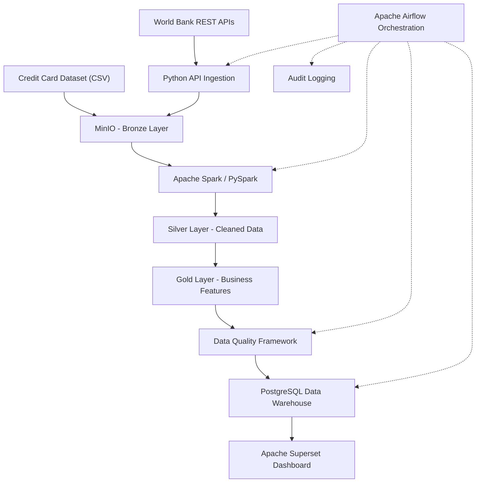
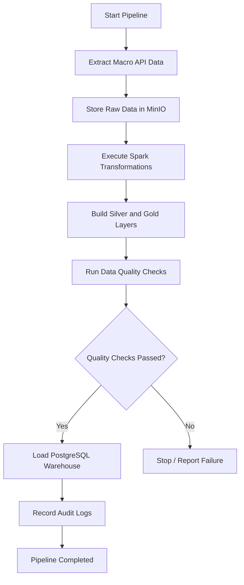

# 🏦 Banking Credit Risk – End-to-End Data Engineering Pipeline

An end-to-end **Banking Credit Risk Data Engineering project** built using Python, Apache Spark, PySpark, Apache Airflow, MinIO, PostgreSQL, and Apache Superset.

This project demonstrates how to design, develop, and orchestrate a scalable data pipeline that ingests credit card customer data and macroeconomic indicators, processes raw data through a Medallion Architecture (Bronze, Silver, and Gold), performs data quality checks, and loads curated datasets into a PostgreSQL data warehouse for analytical reporting.

The project follows modern data engineering practices, including distributed data processing, REST API integration, incremental ingestion, data quality validation, pipeline audit logging, workflow orchestration, and data visualization.

---

## Table of Contents

* [Project Overview](#project-overview)
* [Business Problem](#business-problem)
* [Project Objectives](#project-objectives)
* [Architecture](#architecture)
* [Technology Stack](#technology-stack)
* [Data Sources](#data-sources)
* [Data Pipeline Workflow](#data-pipeline-workflow)
* [Medallion Architecture](#medallion-architecture)
* [Data Transformations](#data-transformations-and-feature-engineering)
* [Data Quality Framework](#data-quality-framework)
* [Data Warehouse Design](#data-warehouse-design)
* [Pipeline Orchestration](#pipeline-orchestration)
* [Incremental Data Ingestion](#incremental-data-ingestion)
* [Audit Logging and Monitoring](#audit-logging-and-monitoring)
* [Dashboard and Analytics](#dashboard-and-analytics)
* [Project Structure](#project-structure)
* [Getting Started](#getting-started)
* [Key Learning Outcomes](#key-learning-outcomes)

---

## Project Overview

Financial institutions rely on customer credit information and economic indicators to assess credit exposure, monitor repayment behaviour, and understand portfolio risk.

This project builds a complete data engineering solution that combines:

1. **Credit Card Customer Data:** Customer demographics, credit limits, repayment history, billing amounts, and payment information.
2. **Macroeconomic Data:** GDP growth, inflation, and unemployment indicators retrieved through public REST APIs.

The pipeline processes these datasets using PySpark, applies data cleansing and business transformations, engineers credit risk features, and generates analytical datasets.

The curated data is stored in a PostgreSQL data warehouse and exposed through Apache Superset dashboards.

The entire workflow is designed to be orchestrated using Apache Airflow.

## Business Problem

Banks need reliable and consolidated data to monitor credit risk across their customer portfolios.

However, credit information and macroeconomic indicators often originate from different systems and data sources.

The objective of this project is to build a centralized data pipeline that:

* Consolidates customer credit and economic data.
* Standardizes and cleans inconsistent source data.
* Identifies customer repayment and credit utilization patterns.
* Calculates rule-based customer risk scores.
* Categorizes customers into Low, Medium, and High risk bands.
* Validates data quality before loading it into the warehouse.
* Provides analytical datasets for credit risk monitoring.

**Note:** The risk score in this project is a rule-based demonstration metric, not a trained credit-default prediction model or a production lending decision.

## Project Objectives

* Build an end-to-end ETL pipeline using Apache Spark and PySpark.
* Integrate external data sources using Python REST API extraction.
* Implement object storage using MinIO.
* Follow the Bronze, Silver, and Gold Medallion Architecture.
* Perform distributed data transformations using Spark DataFrames.
* Engineer customer credit risk features.
* Implement reusable data quality validations.
* Design a relational star schema in PostgreSQL.
* Automate pipeline execution using Apache Airflow.
* Implement incremental API ingestion.
* Maintain pipeline execution and audit logs.
* Build interactive analytical dashboards using Apache Superset.
* Implement automated tests using Pytest.
* Containerize infrastructure components using Docker Compose.

---

## Architecture

The project follows a modular data engineering architecture.

### High-Level Architecture



### Architecture Components

| Component       | Responsibility                            |
| --------------- | ----------------------------------------- |
| Python          | API extraction and ingestion              |
| REST API        | External macroeconomic data               |
| MinIO           | Object storage for raw and processed data |
| Apache Spark    | Distributed data processing               |
| PySpark         | Data cleaning and feature engineering     |
| PostgreSQL      | Analytical data warehouse                 |
| Apache Airflow  | Pipeline scheduling and orchestration     |
| Apache Superset | Dashboard and visualization               |
| Docker Compose  | Infrastructure and service management     |
| Pytest          | Automated testing                         |

---

## Technology Stack

| Technology              | Purpose                                      |
| ----------------------- | -------------------------------------------- |
| Python                  | API ingestion, pipeline utilities, testing   |
| Apache Spark            | Distributed processing engine                |
| PySpark                 | Data transformations and feature engineering |
| SQL                     | Data warehouse design and analytical queries |
| REST API                | External data integration                    |
| MinIO                   | S3-compatible object storage                 |
| PostgreSQL              | Relational data warehouse                    |
| Apache Airflow          | Workflow orchestration                       |
| Apache Superset         | Data visualization                           |
| Docker & Docker Compose | Containerization                             |
| Pytest                  | Unit and integration testing                 |
| Git & GitHub            | Version control and project documentation    |

All core technologies used in this project are open-source.

---

## Data Sources

### 1. Credit Card Default Dataset

A publicly available credit card customer dataset containing approximately 30,000 customer records.

The dataset includes:

* Customer ID
* Credit limit
* Gender
* Education
* Marital status
* Age
* Historical repayment status
* Monthly billing amounts
* Monthly payment amounts
* Credit default indicator

Source: [UCI Machine Learning Repository – Default of Credit Card Clients](https://archive.ics.uci.edu/dataset/350/default+of+credit+card+clients)

### 2. World Bank Open Data API

Macroeconomic indicators are extracted using Python REST API integration.

The project uses the following indicators:

| Indicator    | World Bank Indicator Code |
| ------------ | ------------------------- |
| GDP Growth   | NY.GDP.MKTP.KD.ZG         |
| Inflation    | FP.CPI.TOTL.ZG            |
| Unemployment | SL.UEM.TOTL.ZS            |

Country: India (IND)

API source: [World Bank Open Data API](https://data.worldbank.org/)

The extracted API responses are stored in MinIO in JSON format.

---

## Data Pipeline Workflow

The pipeline consists of the following stages:

### 1. Data Ingestion

* Read the credit card dataset from CSV.
* Extract GDP growth data through the World Bank API.
* Extract inflation data through the World Bank API.
* Extract unemployment data through the World Bank API.
* Store raw API responses in MinIO.

### 2. Data Processing

Use PySpark to:

* Read CSV and JSON files.
* Apply schema validation.
* Standardize column names and data types.
* Handle missing and invalid records.
* Remove duplicate records.
* Calculate customer credit risk features.
* Generate customer risk scores and risk categories.

### 3. Data Quality Validation

Validate:

* Mandatory fields.
* Null values.
* Duplicate customer records.
* Invalid credit limits.
* Invalid customer ages.
* Invalid default indicators.
* Missing macroeconomic values.
* Business rule violations.

### 4. Data Warehouse Loading

* Create dimensional and fact tables in PostgreSQL.
* Load customer dimensions.
* Load risk band dimensions.
* Load macroeconomic dimensions.
* Load customer credit risk facts.

### 5. Reporting and Visualization

Connect Apache Superset to PostgreSQL and create dashboards for:

* Customer risk distribution.
* Credit default rate.
* Credit utilization.
* Customer repayment behaviour.
* Macroeconomic indicators.

---

## Medallion Architecture

The project implements the Medallion Architecture to organize data processing into three layers.

### Bronze Layer – Raw Data

Stores source data in its original or minimally processed format.

**Sources:**

* Credit card default CSV.
* GDP growth API JSON.
* Inflation API JSON.
* Unemployment API JSON.

**Storage:** MinIO object storage.

Example structure:

```text
banking-risk/
└── bronze/
    └── macro_api/
        ├── gdp_growth/
        ├── inflation/
        └── unemployment/
```

### Silver Layer – Cleaned and Standardized Data

Contains validated and transformed datasets.

Processing includes:

* Data type conversion.
* Column standardization.
* Null handling.
* Duplicate removal.
* Invalid record handling.
* Standardized macroeconomic records.

**Storage format:** Parquet.

### Gold Layer – Business-Ready Data

Contains curated datasets designed for analytics and reporting.

Gold datasets include:

* Customer risk details.
* Customer risk scores.
* Risk band classifications.
* Portfolio risk summaries.
* Macroeconomic indicator summaries.

**Storage format:** Parquet.

---

## Data Transformations and Feature Engineering

PySpark is used for all major data transformations.

The pipeline derives the following features:

| Feature                  | Description                                       |
| ------------------------ | ------------------------------------------------- |
| Credit Utilization Ratio | Outstanding bill amount divided by credit limit   |
| Total Bill Amount        | Aggregate billing amount across available periods |
| Total Payment Amount     | Aggregate payment amount across available periods |
| Maximum Payment Delay    | Maximum historical repayment delay                |
| Late Payment Count       | Number of periods with delayed repayment          |
| Payment-to-Bill Ratio    | Total payments divided by total bills             |
| Risk Score               | Rule-based score calculated from credit behaviour |
| Risk Band                | Low, Medium, or High risk classification          |

### Risk Classification

Customers are categorized into three risk bands based on their calculated risk scores.

| Risk Band   | Description                                                   |
| ----------- | ------------------------------------------------------------- |
| Low Risk    | Relatively healthy repayment and credit utilization behaviour |
| Medium Risk | Moderate credit exposure or repayment concerns                |
| High Risk   | Higher credit utilization and/or significant repayment delays |

The risk scoring logic is configurable and can be extended with additional business rules.

### Macroeconomic Analysis

GDP growth, inflation, and unemployment data are standardized and consolidated to support macroeconomic trend analysis.

Since the credit card dataset does not contain a corresponding historical observation date, the latest available macroeconomic snapshot is treated as contextual information rather than a historical causal relationship with individual customer defaults.

---

## Data Quality Framework

A reusable data quality framework is implemented using PySpark.

The framework validates the data before it is loaded into the Gold layer and PostgreSQL warehouse.

### Validation Rules

| Check                  | Expected Result                       |
| ---------------------- | ------------------------------------- |
| Customer ID            | Must not be null                      |
| Customer ID uniqueness | No duplicate customer IDs             |
| Credit limit           | Must be positive                      |
| Customer age           | Must be within an acceptable range    |
| Default flag           | Must contain only valid binary values |
| Risk score             | Must be within the configured range   |
| Risk band              | Must be Low, Medium, or High          |
| Macro year             | Must be valid                         |
| Macro values           | Must not contain invalid values       |

Failed validations are reported so that data issues can be investigated before downstream loading.

---

## Data Warehouse Design

PostgreSQL is used as the analytical data warehouse.

The project follows a dimensional modeling approach using a star schema.

### Dimension Tables

**1. dim_customer**

Contains customer demographic information.

**2. dim_risk_band**

Contains risk classification information.

**3. dim_macro_economy**

Contains macroeconomic indicator information.

### Fact Table

**fact_customer_risk**

Contains customer-level credit risk metrics and measures.

Example measures:

* Risk score.
* Credit utilization ratio.
* Total bill amount.
* Total payment amount.
* Late payment count.
* Default indicator.


## Pipeline Orchestration

Apache Airflow is used to orchestrate the ETL workflow.

The DAG coordinates the execution of individual pipeline stages.

### Pipeline Execution Flow



Airflow provides:

* Centralized workflow management.
* Task dependency management.
* Scheduled execution.
* Task-level execution status.
* Failure handling.
* Pipeline retry capabilities.

---

## Incremental Data Ingestion

The macroeconomic API ingestion process supports incremental extraction.

Instead of repeatedly downloading the entire historical dataset, the pipeline maintains extraction state and identifies the latest successfully ingested year.

Subsequent executions request only the required newer records.

Benefits:

* Reduced API requests.
* Faster ingestion.
* Avoidance of unnecessary duplicate data.
* Better support for scheduled pipeline execution.

---

## Audit Logging and Monitoring

Pipeline execution details are captured for monitoring and troubleshooting.

The audit framework records information such as:

* Pipeline run ID.
* Pipeline name.
* Execution step.
* Start timestamp.
* End timestamp.
* Execution status.
* Number of records processed.
* Error details.

This provides traceability across the different stages of the ETL pipeline.

---

## Dashboard and Analytics

Apache Superset is used to visualize the curated data stored in PostgreSQL.

The Banking Credit Risk Dashboard is designed to provide an overview of customer credit risk and portfolio behaviour.

### Planned Dashboard KPIs

* Total Customers.
* Overall Default Rate.
* High-Risk Customer Count.
* Average Customer Risk Score.
* Average Credit Utilization.

### Planned Visualizations

| Visualization                   | Business Purpose                                  |
| ------------------------------- | ------------------------------------------------- |
| Risk Band Distribution          | Understand customer risk segmentation             |
| Default Rate by Risk Band       | Compare observed default rates across risk groups |
| Credit Utilization Distribution | Analyze customer credit exposure                  |
| Repayment Behaviour             | Understand historical repayment patterns          |
| GDP Growth Trend                | Monitor economic growth                           |
| Inflation Trend                 | Monitor inflation                                 |
| Unemployment Trend              | Monitor unemployment                              |

---

## Project Structure

```text
banking-credit-risk/
│
├── api/
│   └── World Bank API extraction scripts
│
├── config/
│   └── Application and environment configuration
│
├── dags/
│   └── Airflow DAG definitions
│
├── data/
│   ├── raw/
│   ├── silver/
│   └── gold/
│
├── docs/
│   ├── architecture/
│   └── screenshots/
│
├── ingestion/
│   └── Data ingestion modules
│
├── quality/
│   └── Data quality validation modules
│
├── spark/
│   ├── spark_session.py
│   ├── read_raw_data.py
│   ├── clean_data.py
│   └── feature_engineering.py
│
├── sql/
│   ├── create_schema.sql
│   └── analytical_queries.sql
│
├── tests/
│   └── Pytest test cases
│
├── Dockerfile.airflow
├── Dockerfile.superset
├── docker-compose.yml
├── requirements.txt
├── requirements-airflow.txt
├── .env.example
├── .gitignore
└── README.md
```

*The structure above is a logical project overview; individual filenames can evolve as the implementation grows.*

---

## Getting Started

### Prerequisites

Install the following:

* Python
* Java
* Apache Spark
* Docker
* Docker Compose
* Git

### 1. Clone the Repository

```bash
git clone https://github.com/hawasaish/data-engineering-portfolio.git

cd data-engineering-portfolio/banking-credit-risk
```

### 2. Create a Python Virtual Environment

```bash
python3 -m venv .venv

source .venv/bin/activate
```

### 3. Install Dependencies

```bash
pip install -r requirements.txt
```

### 4. Configure Environment Variables

Create your local `.env` file using the example:

```bash
cp .env.example .env
```

Configure the required MinIO and PostgreSQL connection details.

### 5. Start Infrastructure

```bash
docker compose up -d
```

### 6. Execute the Data Pipeline

Run the extraction, Spark transformation, data quality, and warehouse loading scripts in the configured execution order.

Airflow can subsequently be used to orchestrate the workflow.

*Refer to the individual pipeline scripts and configuration files for exact execution commands.*

---

## Key Learning Outcomes

This project demonstrates practical experience in:

* Designing end-to-end data engineering pipelines.
* Integrating external REST APIs using Python.
* Processing structured and semi-structured data using PySpark.
* Implementing Medallion Architecture.
* Building reusable data transformation modules.
* Performing data quality validation.
* Designing dimensional data warehouse models.
* Implementing incremental ingestion.
* Orchestrating workflows using Apache Airflow.
* Managing object storage using MinIO.
* Containerizing services using Docker Compose.
* Building analytical dashboards using Apache Superset.
* Writing automated tests using Pytest.

---

## 👨‍💻 Author

**Saish Hawa**

Data Engineer | Python | PySpark | Apache Spark | Scala | SQL | Data Engineering

GitHub: [@hawasaish](https://github.com/hawasaish)

---

⭐ If you find this project useful, feel free to explore the repository and share your feedback.

**Disclaimer:** This is an educational portfolio project built using publicly available datasets and APIs. The risk scoring logic is illustrative and is not intended for actual credit approval, lending, or financial decision-making.
